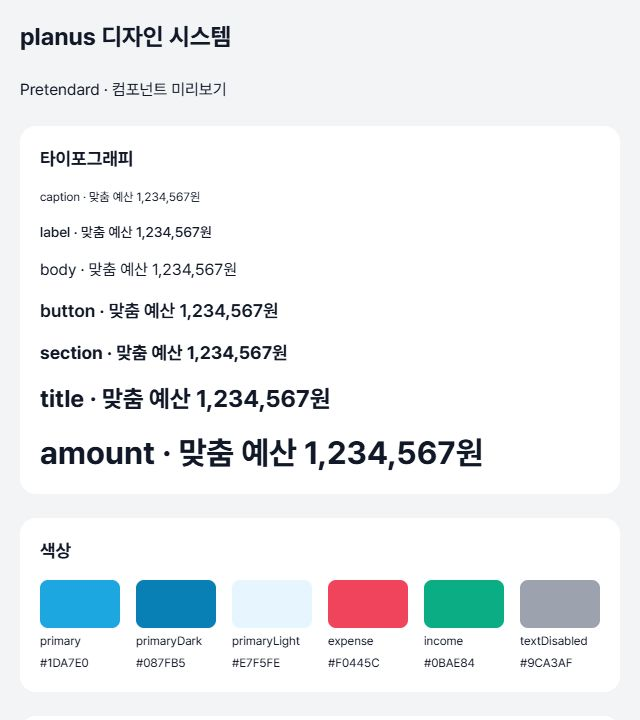
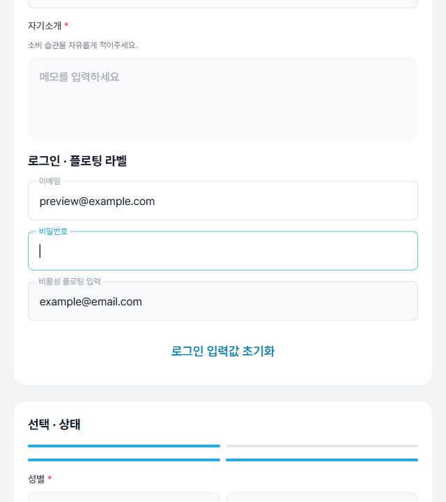
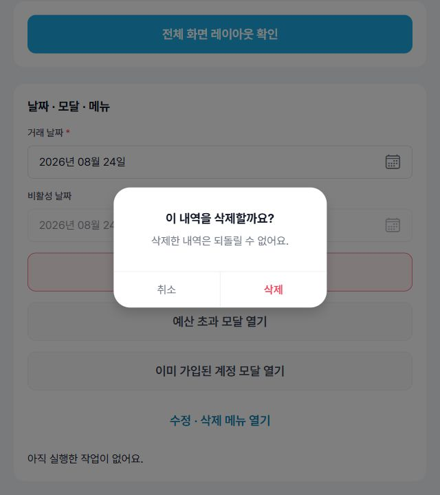

# PlanUs 디자인 시스템

## 목적과 구조

PlanUs의 공통 UI 컴포넌트, 디자인 토큰 및 사용 규칙을 정의한다. 공통 컴포넌트는 표시와 사용자 입력을 담당하며, 카테고리 데이터·예산 계산·API 호출은 포함하지 않는다. 값과 변경 콜백은 호출자가 전달한다.

- 공통 컴포넌트: `src/components/common/`
- 디자인 토큰: `src/constants/`
- 개발용 미리보기: `src/screens/dev/`
- 폰트 및 이미지: `assets/`

## 미리보기 실행

프로젝트 루트인 `my-app` 폴더에서 실행한다.

```sh
npm ci
npm run preview
```

미리보기는 개발 환경에서 `EXPO_PUBLIC_DESIGN_SYSTEM_PREVIEW=1`인 경우에만 표시된다. 실행 스크립트는 이 플래그를 설정하고 `.env` 로딩을 비활성화한다. 배포 빌드에서는 미리보기에 진입할 수 없다.

추가 실행 옵션은 다음과 같이 전달한다. PowerShell에서 인자가 전달되지 않으면 `npm.cmd`를 사용한다.

```sh
npm run preview -- --offline --port 8082 --max-workers 2
```

일반 앱은 미리보기 서버를 종료한 뒤 `npm start` 또는 `npm run web`으로 실행한다.

## 디자인 토큰과 폰트

- `src/constants/colors.ts`: 대표 파랑 `#1DA7E0`, 강조 글자 `#087FB5`, 선택 배경 `#E7F5FE`, 지출/삭제 `#F0445C`, 수입 `#0BAE84`, 표면/테두리/비활성 상태.
- `src/constants/typography.ts`: Pretendard Regular 400, Medium 500, SemiBold 600, Bold 700. `caption`, `label`, `body`, `button`, `section`, `title`, `amount` 역할 제공.
- `src/constants/layout.ts`: 간격, 모서리, 최소 터치 영역, 화면 최대 너비, 모달 너비와 그림자.

색상과 치수는 제공된 화면 이미지를 기준으로 정의했다. 정확한 디자인 수치가 확정되면 토큰에서 조정한다. 색상은 의미별 토큰을, 글자 크기는 타이포 역할과 크기 스케일을 사용한다.

Pretendard는 공식 저장소의 **v1.3.9** 정적 TTF 4종을 로컬 번들에 포함했다. 출처는 [Pretendard 공식 저장소](https://github.com/orioncactus/pretendard)이며 SIL Open Font License 전문은 `assets/fonts/LICENSE.txt`에 있다. CDN 접속 없이 동작한다. `FontProvider`는 로딩을 기다리고 실패 시 재시도 화면을 표시한다.

글자와 입력 요소는 공통 `Text`와 `TextInput`을 사용한다. 굵기는 `weight="regular|medium|semibold|bold"` 또는 `fontFamily` 토큰으로 지정한다. 중첩 강조는 `variant="inherit"`로 부모 크기·색을 상속한다. 폰트 로딩 실패 안내만 시스템 폰트를 사용한다. 달력 내부 폰트도 Pretendard로 지정했다.

## 컴포넌트 사용 규칙

모든 공통 UI는 `src/components/common/<Name>`의 named export를 사용한다. 업무 목록·계산·조회는 호출자가 담당한다.

| 영역      | 컴포넌트와 인터페이스                                                                                                                                           |
| --------- | --------------------------------------------------------------------------------------------------------------------------------------------------------------- |
| 타이포    | `Text`: `variant`, `weight`, Native Text props. `TextInput`: `weight`, ref/이벤트/입력 props                                                                    |
| 액션      | `Button`: `label`, `variant`, `size`, `disabled`, `loading`, `fullWidth`. `IconButton`: `name`, `label` 필수                                                    |
| 폼        | `FormField`: `label`, `required`, `hint`, `error`. 오류는 도움말보다 우선                                                                                       |
| 입력      | `Input`: `variant="box"/"underline"/"floating"`, `suffix`, `rightIcon`, `onRightPress`. `style`은 입력 글자, `containerStyle`은 테두리 영역                     |
| 금액      | `AmountInput`: `value`와 `onChangeText`는 콤마 없는 숫자 문자열. 화면에만 콤마 표시, 최대 15자리. 비어 있는 값과 0을 구분                                       |
| 긴 글     | `TextArea`: 폼 속성·기본 입력 이벤트·`minHeight` 지원                                                                                                           |
| 선택      | `ToggleGroup`: `options`, `selectedValue`, `onSelect`. `SegmentedControl`: `options`, `value`, `onChange`                                                       |
| 칩        | `Chip`, `ChipGroup`: 선택값·콜백·옵션별 아이콘·비활성 지원. 그룹은 단일 선택                                                                                    |
| 상태      | `Checkbox`: `checked`, `onChange`, 설명·비활성. `Badge`: primary/danger/neutral                                                                                 |
| 진행      | `ProgressBar`: 원래 단위의 `value`, `max`, 접근성 `label`. 표시만 0~100%로 제한. 0원 예산·NaN·Infinity 방어. `StepIndicator`: 1부터 시작하는 `current`, `total` |
| 레이아웃  | `ScreenLayout`: `header`, `footer`, `scroll`, `contentStyle`. `BottomActionBar`: 고정 CTA와 하단 안전 영역                                                      |
| 제목/표면 | `Header`: 제목·뒤로·닫기·우측 액션. `Card`: white/muted/info. `SectionHeader`: 제목·설명·우측 액션. `Divider`: 일반/구역 구분                                   |
| 목록      | `ListRow`: `label`, `value`, `icon`, `onPress`. `ExpandableSection`: `expanded`, `onToggle`로 호출자가 상태 소유                                                |
| 탐색      | `MonthNavigator`: 연도·월·이전/다음 콜백. `TabBar`: 표시용 items/선택값/콜백. 실제 React Navigation 이벤트는 navigator가 담당                                   |
| 모달      | `ConfirmModal`: 제목·강조문·설명·버튼 문구·콜백. `confirmVariant="destructive"`로 삭제 강조, `loading` 중 중복 확인 방지                                        |
| 팝업      | `ActionMenu`: 항목별 id/문구/삭제 강조/비활성/콜백. 어두운 배경 없이 우상단 표시, 선택 시 먼저 닫기                                                             |
| 날짜      | `DateField`: `Date` 값과 확정 콜백. 날짜만 임시 선택 후 확인해야 반영. 취소/배경/뒤로가기는 원래 값 유지                                                        |

```tsx
import { AmountInput } from '@/components/common/AmountInput';
import { Text } from '@/components/common/Text';

<Text variant="section">목표 저축액</Text>
<AmountInput
  label="매달 저축할 금액"
  required
  variant="underline"
  value={amount}
  onChangeText={setAmount}
/>
```

### 플로팅 라벨 입력

로그인처럼 라벨을 입력창 안에 표시하려면 `Input`의 `variant="floating"`을 사용한다. 포커스하거나 값이 있으면 라벨이 테두리 위로 이동한다. 비어 있고 포커스를 잃으면 입력창 안으로 돌아온다. `label`은 접근성 이름으로도 사용하며, 명시적인 이름이 필요하면 `accessibilityLabel`로 지정한다.

```tsx
<Input
  variant="floating"
  label="이메일"
  value={email}
  onChangeText={setEmail}
  autoCapitalize="none"
  keyboardType="email-address"
  autoComplete="email"
/>
```

오류가 있으면 라벨과 테두리에 오류 색상을 표시한다. `editable={false}`이면 비활성 상태로 표시한다. 초기값·외부 값 초기화·`defaultValue`를 사용하는 입력에서도 같은 라벨 규칙을 적용한다.

`ScreenLayout`의 footer에는 `BottomActionBar` 또는 `TabBar`를 전달한다. 두 컴포넌트 모두 하단 안전 영역을 처리하므로 같은 footer에 중첩하지 않는다. 미리보기의 TabBar 예시는 독립된 UI 확인용이며 업무 화면 이동을 수행하지 않는다.

## 브랜드 이미지

다음 PNG 에셋은 원본 해상도와 투명도를 유지한다.

| 내용      | 저장 파일                                               |
| --------- | ------------------------------------------------------- |
| 파란색 P  | `assets/images/brand/planus-logo-3d.png`                |
| 분석 문서 | `assets/images/illustrations/budget-analysis-3d.png`    |
| 저금통    | `assets/images/illustrations/savings-piggy-bank-3d.png` |
| 달력      | `assets/images/illustrations/budget-calendar-3d.png`    |

브랜드 이미지와 앱 런처 아이콘은 별도로 관리한다. 앱 아이콘·스플래시·favicon 설정은 `app.json`을 기준으로 한다.

## 변경 시 검증

```sh
npm run typecheck
npm run lint
npx prettier --check src App.tsx
npx expo export --platform web --output-dir dist/design-system-web --max-workers 2
```

미리보기에서 기본·선택·비활성·오류·로딩 상태와 입력·모달·날짜 선택 동작을 확인한다. 좁은 화면, 긴 한글, 큰 금액과 키보드 사용도 함께 확인한다. iOS·Android의 글자 확대, 가상 키보드 및 안전 영역은 해당 플랫폼에서 별도로 검증한다.

## 화면 예시

개발용 Web 미리보기에서 확인할 수 있는 공통 UI 예시다.

| 디자인 토큰                                         | 플로팅 라벨 입력                                     | 확인 모달                                   |
| --------------------------------------------------- | ---------------------------------------------------- | ------------------------------------------- |
|  |  |  |
